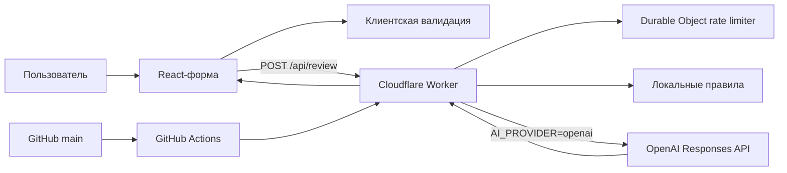

# Архитектура проекта

## Карта системы

Паспорта не сохраняются: они существуют в состоянии браузера, отправляются только на проверку и не записываются Worker'ом или Durable Object'ом. Для OpenAI включён `store: false`.

## Frontend

| Что | Где | Роль |
| --- | --- | --- |
| Точка входа | `screens/main.js` | Состояние формы, 8 шагов, валидация, запрос проверки, экраны результата и успеха. |
| Контент шагов | `screens/flow.content.js` | Служебные тексты и описание флоу. |
| Оболочка шагов | `screens/shell/FlowShell.js` | Заголовок, прогресс, навигация и sticky-footer. |
| Стили формы | `screens/passport.css` | Только раскладка/композиция поверх Taiga UI. |
| Дизайн-система | `screens/runtime.js` | React и компоненты Taiga UI Proprietary. |
| HTML и тема | `index.html` | Тема `desktop-day` и начальная страница. |

Форма собирает один payload в `reviewPayload()` из `screens/main.js`. Этот формат является контрактом с `POST /api/review`.

В `passport.hypotheses` передаётся массив гипотез с полями `if`, `then` и `because`; пустой массив допустим. Каждый объект в `passport.metrics` содержит `name`, `current`, `unit`, `currentDate` и `target`; `currentDate` может быть `null`. Формат должны синхронно понимать frontend, `shared/review-rules.mjs`, Node API и Worker API.

### Сценарий пользователя

1. Восемь шагов формы проверяют обязательные поля на клиенте.
2. На последнем шаге форма вызывает `/api/review`.
3. Экран ожидания показывает прогресс, пока идёт сетевой запрос.
4. Экран результатов показывает рекомендации. Кнопка исправления возвращает на соответствующий шаг; после «Готово» — обратно к результатам.
5. При отсутствии замечаний пользователь копирует итоговое Markdown-описание для эпика.

## Проверка данных

Есть два независимых слоя.

| Слой | Где | Задача |
| --- | --- | --- |
| Валидация формы | `screens/main.js` | Проверяет, что заполнены обязательные данные; показывает ошибку поля или toast Taiga UI. |
| Содержательная проверка | `shared/review-rules.mjs`, `ai/review-rules.json` | Даёт рекомендации по качеству описания. |

`ai/fixtures/` содержит эталонные паспорта. `scripts/review-check.mjs` гарантирует, что изменения правил не сломают базовые сценарии.

## API и окружения

| Endpoint | Метод | Ответственность |
| --- | --- | --- |
| `/health` | `GET` | Проверка доступности и текущего AI-провайдера. |
| `/api/review` | `POST` | Содержательная проверка payload с полем `passport`. |

### Локально

`scripts/dev.mjs` запускает esbuild и Node HTTP-сервер. `server/api.mjs` направляет запрос в `server/review.mjs`; там выбирается mock или OpenAI. Лимит запросов хранится в памяти процесса (`server/rate-limit.mjs`).

### Production

`wrangler.jsonc` описывает Cloudflare Worker. `worker/index.mjs` обслуживает API и передаёт остальные пути в статические assets из `dist/`. Лимит запросов хранится в Durable Object `RateLimiter`, отдельно для IP-адреса, поэтому он переживает перезапуски Worker'а.

Если OpenAI недоступен, Worker не возвращает ошибку пользователю: он использует локальные правила и передаёт `warning`, который frontend показывает toast'ом.

## Внешние зависимости

| Зависимость | Для чего | Где закреплена |
| --- | --- | --- |
| React 18 | Рендеринг интерфейса. | `package.json`, `package-lock.json` |
| Taiga UI Proprietary | Компоненты, токены, шрифт и иконки. | `vendor/taiga-ui-proprietary-3.16.0.tgz` |
| esbuild | Локальная и production-сборка. | `scripts/dev.mjs` |
| Wrangler 4 | Локальная проверка и Cloudflare deployment. | `package.json`, `wrangler.jsonc` |
| OpenAI Responses API | Содержательные рекомендации при `AI_PROVIDER=openai`. | `server/openai.mjs`, `worker/index.mjs` |

Архив Taiga UI намеренно хранится в репозитории: благодаря этому `npm ci` воспроизводим на другой машине без доступа к приватному пакету.

